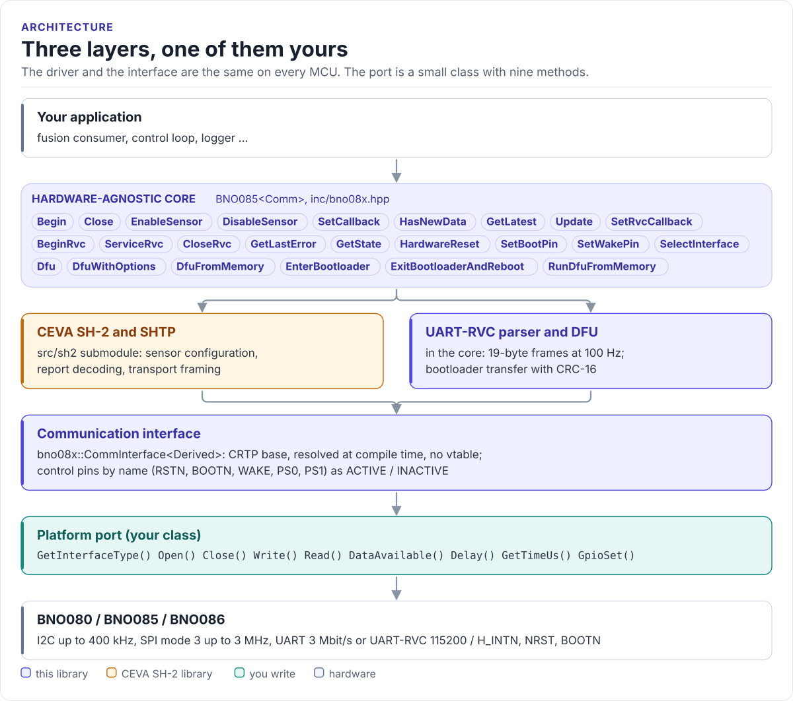

# BNO08x Driver

A C++20 driver for the CEVA BNO080, BNO085 and BNO086 9-axis IMU: start the SH-2 sensor hub, enable fused
orientation, motion and activity reports, stream UART-RVC or update the firmware, from any MCU with I2C, SPI or
UART.

[](https://github.com/hardfoc/hf-bno08x-driver/actions/workflows/ci-host-tests.yml)
[](https://github.com/hardfoc/hf-bno08x-driver/actions/workflows/esp32-examples-build-ci.yml)
[](https://hardfoc.github.io/hf-bno08x-driver/)
[](LICENSE)

**Documentation: <https://hardfoc.github.io/hf-bno08x-driver/>**

<!-- figure: driver-layers -->
<picture>
  <source media="(prefers-color-scheme: dark)" srcset="docs/diagrams/driver-layers.dark.svg">
  
</picture>
<!-- /figure -->

## In 30 seconds

Write a small port class for your MCU (I2C transfers, H_INTN, NRST, a delay and a microsecond clock;
[Porting](https://hardfoc.github.io/hf-bno08x-driver/latest/porting/)), then:

<!-- generated: quickstart-code -->
```cpp
#include "bno08x.hpp"

#include <cstdio>

int print_orientation(MyI2c& bus) {
  BNO085<MyI2c> imu(bus);

  imu.HardwareReset();         // 1. pulse NRST
  if (!imu.Begin()) {          // 2. open the bus, start SH-2
    return imu.GetLastError(); //    SH2_ERR_* from sh2_err.h
  }
  if (!imu.EnableSensor(BNO085Sensor::RotationVector, 10)) { // 3. orientation every 10 ms
    return imu.GetLastError();
  }
  for (;;) {
    imu.Update(); // 4. service the hub
    if (imu.HasNewData(BNO085Sensor::RotationVector)) {
      const Quaternion q = imu.GetLatest(BNO085Sensor::RotationVector).rotation;
      std::printf("w=%.3f x=%.3f y=%.3f z=%.3f accuracy=%u\n", q.w, q.x, q.y, q.z,
                  static_cast<unsigned>(q.accuracy));
    }
    bus.Delay(2);
  }
}
```
<!-- /generated -->

## What it does

- Starts the hub through CEVA's own SH-2 library and enables any of 40 report types at the rate you ask.
- Decodes every report into one `SensorEvent`: quaternions, vectors in m/s², rad/s and µT, steps, taps,
  classifiers. Read them with a callback, by polling, or both.
- Re-enables your reports when the hub resets.
- Parses UART-RVC frames (heading, pitch, roll, acceleration at 100 Hz) with no protocol stack.
- Updates the hub's firmware through the bootloader from an image in memory, with CRC-16 and retries.
- No threads, no RTOS, no virtual calls (the port is a CRTP class).

## Install

```bash
git submodule add https://github.com/hardfoc/hf-bno08x-driver.git external/hf-bno08x-driver
git submodule update --init external/hf-bno08x-driver/src/sh2
```

```cmake
add_subdirectory(external/hf-bno08x-driver)
target_link_libraries(my_app PRIVATE hf_bno08x)
```

ESP-IDF: use the component wrapper in [`examples/esp32/components/hf_bno08x`](examples/esp32/components/hf_bno08x/CMakeLists.txt).
Details: [Installation](https://hardfoc.github.io/hf-bno08x-driver/latest/installation/).

## Documentation

| | |
| --- | --- |
| [Quickstart](https://hardfoc.github.io/hf-bno08x-driver/latest/quickstart/) | Wire it, write the port, read orientation |
| [Hardware](https://hardfoc.github.io/hf-bno08x-driver/latest/hardware/) | Pins, protocol selection, bus settings, timing |
| [API guide](https://hardfoc.github.io/hf-bno08x-driver/latest/api-guide/) | Start, enable reports, read, handle errors |
| [UART-RVC mode](https://hardfoc.github.io/hf-bno08x-driver/latest/rvc/) | Orientation over one UART line |
| [Firmware update](https://hardfoc.github.io/hf-bno08x-driver/latest/dfu/) | The bootloader sequence and options |
| [API reference](https://hardfoc.github.io/hf-bno08x-driver/latest/api/) | Doxygen, every class and member |

The pages are in [`docs/`](docs/index.md); the datasheet is in [`docs/datasheet/`](docs/datasheet/).

## Tests

```bash
cmake -S . -B build-host -DHF_BNO08X_BUILD_TESTS=ON && cmake --build build-host && ctest --test-dir build-host
```

The host tests run the driver against a mock transport; the code on the documentation site is compiled by the
same build.

## License

GPL-3.0 for the driver, see [LICENSE](LICENSE). The CEVA SH-2 library in `src/sh2` and CEVA's DFU files in `src/dfu`
(`HcBin.h`, `firmware.h`, `firmware-bno.c`) are Apache-2.0, under their own notices.
