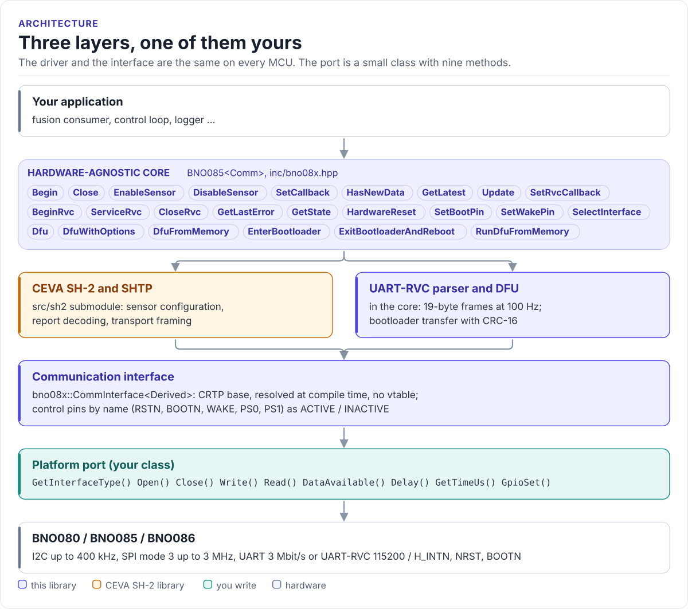
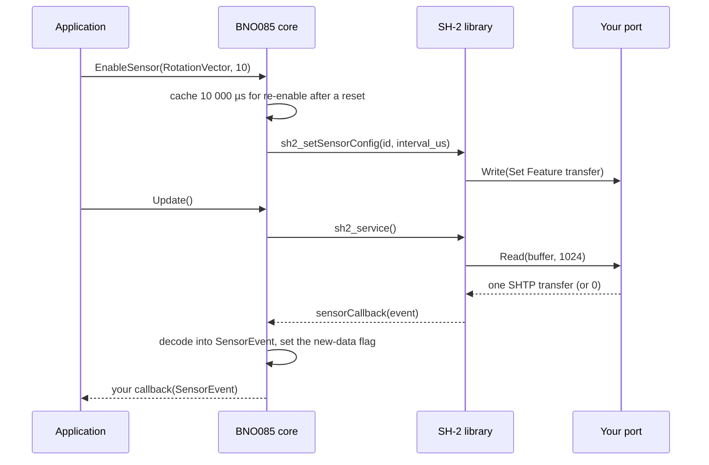
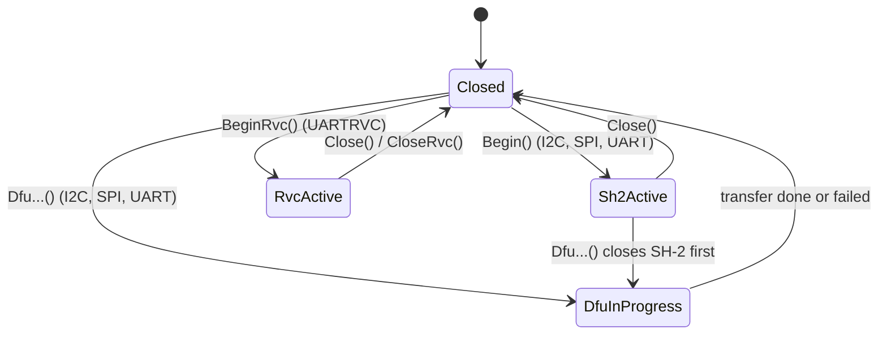

# Architecture

How the driver is put together: the layers, the CEVA SH-2 library underneath, and how one call reaches the hub.

<!-- figure: driver-layers -->
<picture>
  <source media="(prefers-color-scheme: dark)" srcset="diagrams/driver-layers.dark.svg">
  
</picture>
<!-- /figure -->

## The layers

| Layer | Where | Depends on | You change it when |
| --- | --- | --- | --- |
| **Hardware-agnostic core**: `BNO085<Comm>` | [`inc/bno08x.hpp`](../inc/bno08x.hpp) | Interface, SH-2 library | Never |
| **CEVA SH-2 and SHTP library** | [`src/sh2/`](https://github.com/ceva-dsp/sh2) | `sh2_Hal_t` from the core | For CEVA fixes |
| **Communication interface**: `bno08x::CommInterface<Derived>` | [`inc/bno08x_comm_interface.hpp`](../inc/bno08x_comm_interface.hpp) | Your port | Never |
| **Platform port**: your class | Your project | Your SDK | Per MCU ([Porting](porting.md)) |

Everything above the port is the same on ESP32, STM32, a Linux host or the unit-test mock. That is how the
[host tests](testing.md) run the real driver code without hardware.

## How one call reaches the hub

The SH-2 library calls the port through a C function table (`sh2_Hal_t`: `open`, `close`, `read`, `write`,
`getTimeUs`). The core fills it with static trampolines that forward to your port's `Open()`, `Close()`, `Read()`,
`Write()` and `GetTimeUs()`.

## Three modes, one object

The port's `GetInterfaceType()` decides what the object may do, and a small state machine
(`BNO085DriverState`) keeps the modes apart:

A call for the wrong interface fails with `SH2_ERR_BAD_PARAM`; a call in the wrong state fails with
`SH2_ERR_OP_IN_PROGRESS`. `GetLastError()` returns the code.

## Design choices

- **CRTP, not virtual functions.** The interface is a template parameter. The compiler sees your port's methods
  directly and inlines them: no vtable, no RTTI. The cost is that the driver type names the port:
  `BNO085<MyI2c>`.
- **CEVA's library, unmodified.** The SH-2 protocol (sensor configuration, FRS records, report decoding) is
  CEVA's own code, kept as a submodule. The core adds the C++ types, the report cache and the reset handling.
- **A latest-value cache.** Each of the 47 possible sensor IDs keeps its last decoded value and a new-data flag,
  so callbacks and polling work together.
- **One SH-2 session per program.** The CEVA library keeps its state in a single global instance, so one
  `BNO085` object can run SH-2 at a time. UART-RVC objects do not use the library and have no such limit.
- **Not thread-safe.** Call one driver object from one task, or guard it with a mutex.

## Source map

| Path | Contents |
| --- | --- |
| `inc/bno08x.hpp` | `BNO085<Comm>`, `BNO085Sensor`, `SensorEvent`, RVC and DFU types |
| `src/bno08x.ipp` | Template implementation, included by the header |
| `inc/bno08x_comm_interface.hpp` | `CommInterface`, `BNO085Interface`, `CtrlPin`, `GpioSignal` |
| `src/sh2/` | CEVA SH-2 and SHTP library (submodule, Apache-2.0) |
| `src/dfu/` | `HcBin_t` firmware-image interface, `MemoryFirmware`, the stub image |
| `tests/` | Host unit tests and the compiled documentation snippets |
| `examples/esp32/` | ESP-IDF applications |
