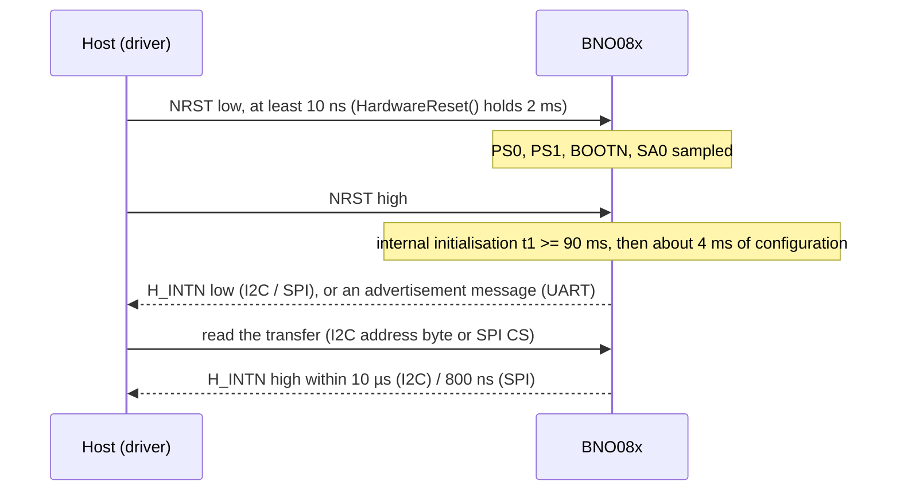

# Hardware

What to connect between your MCU and a BNO08x, with which bus settings, and the board-level traps to avoid.

All values here come from the [BNO08X datasheet](datasheet/BNO080_085-Datasheet.pdf) (CEVA 1000-3927, revision
1.17). Pin numbers are the 28-pin LGA's; a breakout board names them on its silkscreen and often straps some of
them. When the datasheet and a board's schematic disagree, the schematic wins for what is strapped.

## Host interface pins

| Signal | Pin | Direction (chip) | I2C | SPI | UART / UART-RVC |
| --- | --- | --- | --- | --- | --- |
| H_SCL / SCK / RX | 19 | in / bidirectional | SCL | SCK | RX (host to chip) |
| H_SDA / H_MISO / TX | 20 | bidirectional / out | SDA | MISO | TX (chip to host) |
| SA0 / H_MOSI | 17 | in | Address bit 0 | MOSI | n/a |
| H_CSN | 18 | in | n/a | Chip select, active low | n/a |
| H_INTN | 14 | out | Data ready, active low | Data ready, active low | Asserted about 7.7 µs before each UART message (UART-SHTP) |

## Control pins

The driver addresses these by name (`bno08x::CtrlPin`) and by state (`GpioSignal::ACTIVE` / `INACTIVE`); your
port maps a state to a level. ACTIVE means "function asserted", which is a low level on the three active-low pins.

| Pin | `CtrlPin` | Direction (chip) | What it does | Driver use |
| --- | --- | --- | --- | --- |
| NRST (11) | `RSTN` | in | Active-low reset | `HardwareReset()`, `EnterBootloader()`, `ExitBootloaderAndReboot()` |
| BOOTN (4) | `BOOTN` | in | Low at reset: start the bootloader. Pull up through 10 kΩ | `SetBootPin()`, the bootloader helpers |
| PS0 / WAKE (6) | `PS0`, `WAKE` | in | Protocol select bit 0 at reset; in SPI mode, an active-low wake afterwards | `SelectInterface()`, `SetWakePin()` |
| PS1 (5) | `PS1` | in | Protocol select bit 1 at reset | `SelectInterface()` |

## Protocol selection

PS1, PS0 and BOOTN are sampled at reset (datasheet figure 1-5). Strap them, or drive them before you release NRST.

| PS1 | PS0 | Application (BOOTN = 1) | Bootloader (BOOTN = 0) | `BNO085Interface` |
| :---: | :---: | --- | --- | --- |
| 0 | 0 | I2C | I2C | `I2C` |
| 0 | 1 | UART-RVC | Reserved | `UARTRVC` |
| 1 | 0 | UART (SHTP) | UART | `UART` |
| 1 | 1 | SPI | SPI | `SPI` |

!!! warning "`SelectInterface()` swaps UART and UART-RVC"
    In this release `SelectInterface(BNO085Interface::UART)` drives PS1 low and PS0 high, which selects UART-RVC,
    and `SelectInterface(BNO085Interface::UARTRVC)` selects UART-SHTP. I2C and SPI are correct. Strap the pins in
    hardware, or drive PS0 and PS1 from your own code with the table above.

## Bus settings

=== "I2C"

    | Setting | Value |
    | --- | --- |
    | Speed | 100 kHz (standard) or 400 kHz (fast) |
    | Address (7-bit) | `0x4A` (SA0 low) or `0x4B` (SA0 high); bootloader `0x28` / `0x29` |
    | Transactions | Plain writes and reads, no register address, no repeated start |
    | Pull-ups | 2 kΩ to 4 kΩ on SCL and SDA, to VDDIO |
    | No data | BNO085 stretches SCL until it has data; BNO086 sends an empty (zero-length) transfer |

=== "SPI"

    | Setting | Value |
    | --- | --- |
    | Mode | Mode 3 (CPOL = 1, CPHA = 1), MSB first, 4-wire |
    | Speed | Up to 3 MHz |
    | Chip select | H_CSN low for a whole transfer; H_INTN deasserts within 800 ns of CS |
    | Wake | Drive PS0/WAKE low; the hub asserts H_INTN within about 150 µs, then clock the transfer |
    | Strapping | PS0 and PS1 high from before reset until the first H_INTN; PS0 must be a GPIO |

=== "UART"

    | Setting | Value |
    | --- | --- |
    | Format | 3 Mbit/s, 8 data bits, no parity, 1 stop bit |
    | Host to chip | At least 100 µs between bytes |
    | Clock | External 32.768 kHz crystal or clock required: the internal oscillator is not accurate enough |

=== "UART-RVC"

    | Setting | Value |
    | --- | --- |
    | Format | 115200 bit/s, 8 data bits, no parity, 1 stop bit |
    | Direction | Chip to host only: one 19-byte frame every 10 ms (100 Hz) |
    | Clock | External 32.768 kHz crystal or clock required |

    The frame format is on the [UART-RVC mode](rvc.md) page.

The SH-2 traffic itself is CEVA's Sensor Hub Transport Protocol (SHTP): every transfer starts with a 4-byte header
(length, channel, sequence). On I2C each read starts at the header again, which is why the
[port](porting.md#what-you-implement) reads the header first and then the whole transfer.

## Start-up and interrupt timing

| Parameter | Value | Source |
| --- | --- | --- |
| NRST low time | at least 10 ns | datasheet figure 6-8 |
| Reset to first H_INTN | at least 90 ms + about 4 ms | figure 6-8 |
| Respond to H_INTN within | about 10 ms, then the hub gives up and retries | section 1.2.4.1 |
| Wake to H_INTN (SPI) | about 150 µs | figure 6-12 |

Handle H_INTN within a tenth of your fastest report period: late responses starve the fusion processing and add
errors. `HardwareReset()` waits 50 ms after releasing NRST; `Begin()` then waits up to 200 ms for the hub's reset
message, which covers the 94 ms start-up.

## Power

| Supply | Range | Notes |
| --- | --- | --- |
| VDD (sensors) | 2.4 V to 3.6 V | Must reach its level before or together with VDDIO |
| VDDIO (core and I/O) | 1.7 V to 3.6 V | Sets the logic levels of every pin |
| CAP (pin 9) | 100 nF to GND | External capacitor |

Typical consumption, measured by CEVA over SPI at VDDIO 3 V and VDD 3.3 V: 0.39 mW idle, about 35 mW for
100 Hz 9-axis fusion and about 46 mW for the gyro-integrated rotation vector at 1 kHz. ENV_SCL and ENV_SDA
(pins 15, 16) need pull-ups even with no environmental sensor fitted, because the firmware probes them at reset.

## Errata and traps that affect the host

!!! danger "Respond to H_INTN"
    The BNO085 and BNO086 retry a transfer the host did not collect within about 10 ms. A host that polls slowly
    sees lost reports and degraded fusion. Wire H_INTN, make `DataAvailable()` read it, and call `Update()` often.

- **I2C clock stretching.** A BNO085 polled with no data holds SCL low until it has some. Gate reads on H_INTN, and
  give your I2C peripheral a clock-stretch timeout longer than your slowest report period.
- **UART needs a crystal.** UART-SHTP and UART-RVC do not work reliably on the internal oscillator.
- **Bootloader address.** In the bootloader the I2C address moves to `0x28` / `0x29`; a port used for firmware
  updates over I2C must switch address (see [Firmware update](dfu.md)).

## Evaluation setup

The [ESP32 examples](examples.md) run on an ESP32-S3 with a BNO08x breakout over I2C:

| Signal | ESP32-S3 GPIO |
| --- | --- |
| SDA, SCL | 4, 5 (400 kHz, address 0x4B first, then 0x4A) |
| H_INTN | 17 |
| NRST | 16 |
| UART-RVC TX, RX | 21, 20 (the RVC example) |

The pin assignment lives in
[`esp32_bno08x_test_config.hpp`](../examples/esp32/main/esp32_bno08x_test_config.hpp).

## Reference documents

| Document | What it is for |
| --- | --- |
| [BNO08X datasheet](datasheet/BNO080_085-Datasheet.pdf) | Pins, interfaces, timing, report rates, electrical limits |
| [SH-2 reference manual](https://www.ceva-ip.com/wp-content/uploads/2019/10/SH-2-Reference-Manual.pdf) | Report formats, Q-points, commands, FRS records |
| [SHTP specification](https://www.ceva-ip.com/wp-content/uploads/2019/10/Sensor-Hub-Transport-Protocol.pdf) | Transfer header, channels, framing on each bus |
| [CEVA SH-2 library](https://github.com/ceva-dsp/sh2) | The host library in `src/sh2` |
