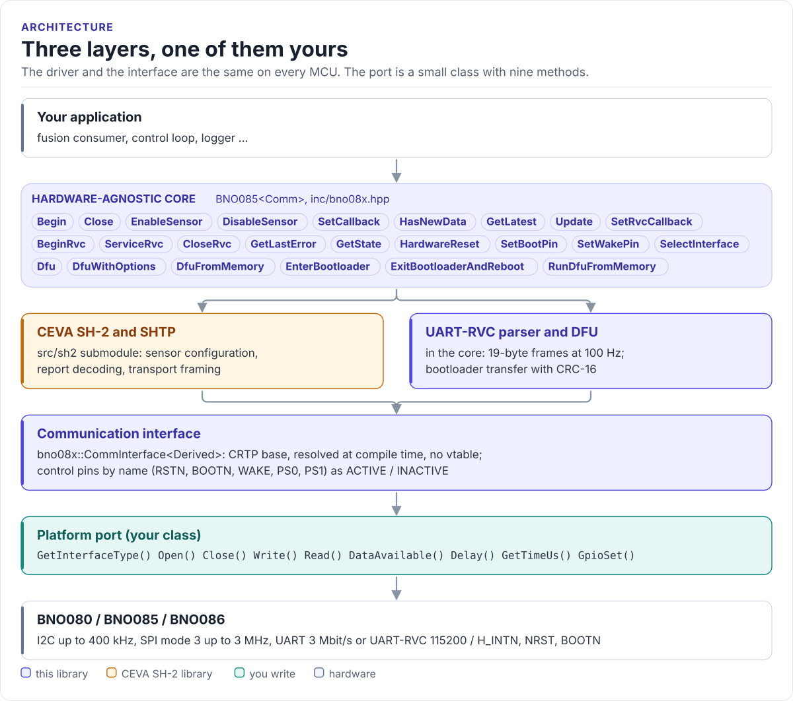

# Porting

Run the driver on a new MCU by writing one class: the communication interface for your bus.

The driver never calls your SDK directly. It calls nine methods on a class you derive from
`bno08x::CommInterface<Self>` (in [`inc/bno08x_comm_interface.hpp`](../inc/bno08x_comm_interface.hpp)). The base
class uses CRTP: the calls are resolved at compile time, so there are no virtual functions and no vtable.

<!-- figure: driver-layers -->
<picture>
  <source media="(prefers-color-scheme: dark)" srcset="diagrams/driver-layers.dark.svg">
  
</picture>
<!-- /figure -->

## What you implement

| Method | Called by | Contract |
| --- | --- | --- |
| `GetInterfaceType()` | `Begin()`, `BeginRvc()`, the DFU calls | Return `I2C`, `SPI`, `UART` or `UARTRVC`; it decides which calls are allowed |
| `Open()` | `Begin()`, `BeginRvc()`, the bootloader helpers, DFU | Initialise the bus and pins. May be called again while open: return `true` without re-initialising |
| `Close()` | `Close()`, `CloseRvc()`, the end of a DFU transfer | Release the bus |
| `Write(data, length)` | SH-2 library, DFU | Send one SHTP transfer (or DFU packet). Return the bytes accepted, 0 if the bus is busy, negative on error |
| `Read(data, length)` | SH-2 library, RVC parser, DFU | SH-2: return one **complete** SHTP transfer, header included, or 0 when there is none. RVC: return whatever bytes have arrived, without blocking |
| `DataAvailable()` | your port, usually inside `Read()` | `true` when H_INTN is low; `true` always when there is no interrupt line |
| `Delay(ms)` | reset and bootloader sequences | Block for at least `ms` milliseconds |
| `GetTimeUs()` | SH-2 timestamps and timeouts, RVC timestamps | A monotonic 32-bit microsecond counter; wrapping is fine |
| `GpioSet(pin, signal)` | `HardwareReset()`, `SetBootPin()`, `SetWakePin()`, `SelectInterface()`, the bootloader helpers | Drive `RSTN`, `BOOTN`, `WAKE`, `PS0`, `PS1`; ignore pins the board does not wire. Return `true`, or `false` on a GPIO error |

`GpioSetActive(pin)` and `GpioSetInactive(pin)` come with the base class.

## GPIO errors

Return `false` from `GpioSet()` when your SDK reports a GPIO failure; a pin the board does not wire is not a
failure, so return `true` for it. The driver passes the status on: `HardwareReset()`, `SetBootPin()`,
`SetWakePin()` and `SelectInterface()` return `false`, and `EnterBootloader()` / `ExitBootloaderAndReboot()` fail
with `SH2_ERR_IO` and close the port again. `HardwareReset()` stops at the failing pin, so it does not wait out a
reset that never happened.

Return a `bool`, not your SDK's status code: the driver rejects any other return type at compile time, so an
`esp_err_t` (where 0 is success) cannot be read as `true`. A port written for the earlier contract, with a `void`
`GpioSet()`, still compiles; the driver treats it as never failing. `Close()` and `Delay()` stay `void`: the
driver has nothing to recover when either goes wrong, so log it in the port.

## I2C port

```cpp title="my_i2c.hpp"
--8<-- "tests/docs/my_i2c.hpp:port"
```

Rules the transfer must follow:

- **Plain transactions.** One START ... STOP per call, no register address, no repeated start.
- **Read the length, then the transfer.** Bits 0 to 14 of the 4-byte SHTP header are the transfer length, header
  included; bit 15 marks a continuation. On I2C every read starts at the header again, so read 4 bytes, then the
  whole length. A zero length is an empty transfer (BNO086 sends them when it has nothing): return 0.
- **Gate on H_INTN.** Reading when the hub has nothing makes a BNO085 stretch the clock until it does.
- **Return a negative value only for a bus failure.** The SH-2 library handles protocol errors.
- **Address hooks for firmware updates.** `GetI2cAddress()` returns the 7-bit address the port talks to and
  `SetI2cAddress(addr)` changes it, also while the bus is open. They are optional (detected at compile time); with
  them the DFU calls reach the bootloader at `0x28` / `0x29` and restore your address afterwards.

## UART-RVC port

```cpp title="my_rvc.hpp"
--8<-- "tests/docs/my_rvc.hpp:port"
```

`ServiceRvc()` calls `Read(&byte, 1)` until it returns 0, so `Read()` must not block. Give the UART a receive
buffer of a few frames (19 bytes each, one every 10 ms) so nothing is lost between calls.

## SPI and UART-SHTP ports

Report `SPI` or `UART` from `GetInterfaceType()` and keep the `Read()` contract (one complete SHTP transfer, or
0). Reference ports for ESP-IDF: [`esp32_bno08x_spi_bus.hpp`](../examples/esp32/main/esp32_bno08x_spi_bus.hpp)
and [`esp32_bno08x_uart_bus.hpp`](../examples/esp32/main/esp32_bno08x_uart_bus.hpp), run by the `spi_polling` and
`uart_shtp_polling` [examples](examples.md). Both implement SH-2 only: the bootloader talks its own byte protocol
on these buses (no SHTP framing), which the reference ports do not switch to, so run firmware updates over I2C
with them.

=== "SPI"

    - Mode 3 (CPOL = 1, CPHA = 1), MSB first, at most 3 MHz (datasheet sections 1.2.4.2 and 6.5.2).
    - PS0/WAKE on a GPIO, high with PS1 from before reset until the first H_INTN (that selects SPI), then the
      active-low wake. `GpioSet()` maps `CtrlPin::PS0` (active high) and `CtrlPin::WAKE` (active low) to that pin.
    - `Read()`: when H_INTN is low, assert CS, clock the 4-byte header, then the rest of the transfer in the same
      CS assertion; a transfer longer than the buffer is finished later as a continuation (section 1.3.1).
    - `Write()`: drive WAKE low, wait for H_INTN (about 150 µs, figure 6-12), then one full-duplex transfer. The
      hub may send at the same time; keep those bytes and return them from the next `Read()`. Return 0 while
      such bytes are unread: the SH-2 library then reads and retries.

=== "UART"

    - 3 Mbit/s, 8N1, with the BNO08x external 32.768 kHz clock or crystal (section 1.2.3).
    - Every transfer is framed: flag `0x7E`, protocol ID (`0x01` SHTP, `0x00` control), the payload with `0x7E`
      and `0x7D` sent as `0x7D, byte ^ 0x20`, flag `0x7E`. Before each frame send the Buffer Status Query
      `7E 00 7E` and wait until the hub reports enough free space (a control frame with a 16-bit little-endian
      count). Send host bytes at least 100 µs apart (section 1.2.3.1).
    - [`bno08x_shtp_uart.hpp`](../inc/bno08x_shtp_uart.hpp) does the framing without platform code:
      `EncodeFrame()` for writes and `FrameDecoder` for every received byte. Return 0 from `Write()` while you
      wait for the buffer status; the SH-2 library keeps calling `Read()` meanwhile.

## Control-pin levels

`GpioSignal::ACTIVE` means "function asserted". On the BNO08x that is a low level for NRST, BOOTN and WAKE, and a
high level (logic 1) for PS0 and PS1. Your `GpioSet()` applies the board's levels; inverters or level shifters
change them.

| Pin | ACTIVE level on the chip | Board without the pin |
| --- | --- | --- |
| `RSTN` | low | Tie NRST to the board reset; `HardwareReset()` then only waits |
| `BOOTN` | low | Pull up through 10 kΩ; no firmware updates |
| `WAKE` | low | Not needed on I2C or UART |
| `PS0`, `PS1` | high | Strap them ([Hardware](hardware.md#protocol-selection)) |

## Reference implementation

The ESP32 examples use [`esp32_bno08x_bus.hpp`](../examples/esp32/main/esp32_bno08x_bus.hpp), an ESP-IDF
`i2c_master` port with H_INTN, NRST and the I2C address hooks,
[`esp32_bno08x_spi_bus.hpp`](../examples/esp32/main/esp32_bno08x_spi_bus.hpp) for SPI,
[`esp32_bno08x_uart_bus.hpp`](../examples/esp32/main/esp32_bno08x_uart_bus.hpp) for UART-SHTP and
[`esp32_uart_rvc_bus.hpp`](../examples/esp32/main/esp32_uart_rvc_bus.hpp) for UART-RVC. Start from them for an
ESP-IDF target. The I2C reference reads the whole 1024-byte buffer on every
`Read()`; the header-first read on this page moves far fewer bytes.

## Check your port

1. Build it: both ports on this page are compiled by the host CI from [`tests/docs/`](../tests/docs/my_i2c.hpp),
   with the driver instantiated over them.
2. Watch H_INTN after `HardwareReset()`: it goes low about 94 ms after NRST rises when the strapping is right.
3. `Begin()` returns `true`: the SH-2 library received the hub's reset message and a reply to a command.
4. Enable `RotationVector` at 10 ms and count reports for a second: about 100 means reads keep up.

## Threads

The driver is not thread-safe, and the CEVA SH-2 library keeps one global session: a second object's `Begin()`
fails with `BNO08X_ERR_SH2_SESSION_IN_USE` while one is open. Give the sensor one owner task that calls
`Update()`, or guard every call on the driver object (and its port) with one mutex.
